  
  
  
  

Estudiante de Ingeniería de Software (VII semestre) en la Universidad Cooperativa de Colombia, Medellín. Desarrollo back-end con **Java y Spring Boot**, sitios web con **React**, apps con **Flutter** y análisis de datos con **Python**. Busco mi **práctica profesional desde enero de 2027**, en desarrollo de software o datos, presencial, híbrida o remota.

  <a href="https://casarendon.com">Casa Rendón</a> ·
  <a href="https://luism7p7.github.io/BlackJack/Casino/public/">BlackJack Royale</a> ·
  <a href="https://glampinghub-mzyu.onrender.com">GlampingHub</a> ·
  <a href="https://luism7p7.github.io/#numi">Numi</a> ·
  <a href="https://luism7p7.github.io/#datos">Analítica de datos</a>
   Videos y detalles de cada proyecto en el <a href="https://luism7p7.github.io">portafolio</a>.

<picture>
  <source media="(prefers-color-scheme: dark)" srcset="https://raw.githubusercontent.com/luism7p7/luism7p7/output/gusano-dark.svg">
  <source media="(prefers-color-scheme: light)" srcset="https://raw.githubusercontent.com/luism7p7/luism7p7/output/gusano.svg">
  
</picture>

