  
  
  
  

  <b>Jugar los niveles:</b>
  <a href="https://casarendon.com">Casa Rendón</a> ·
  <a href="https://luism7p7.github.io/BlackJack/Casino/public/">BlackJack</a> ·
  <a href="https://github.com/luism7p7/glampinghub">GlampingHub</a> ·
  <a href="https://luism7p7.github.io/#numi">Numi</a> ·
  <a href="https://luism7p7.github.io/#datos">Datos</a>
   El video de cada nivel está en el <a href="https://luism7p7.github.io">portafolio</a>.

<picture>
  <source media="(prefers-color-scheme: dark)" srcset="https://raw.githubusercontent.com/luism7p7/luism7p7/output/gusano-dark.svg">
  <source media="(prefers-color-scheme: light)" srcset="https://raw.githubusercontent.com/luism7p7/luism7p7/output/gusano.svg">
  
</picture>

