  
  
  
  

Soy de **Andes, Antioquia**, un pueblo cafetero del suroeste, y hoy estudio **Ingeniería de Software** (VII semestre) en la Universidad Cooperativa de Colombia, en Medellín. Antes de programar administré un kiosco atendiendo clientes y proveedores: de ahí me quedó la costumbre de escuchar a las personas y resolver problemas reales. Trabajo el back-end con **Java y Spring Boot**, sitios web con **React**, apps con **Flutter** y análisis de datos con **Python**.

Busco mi **práctica profesional desde noviembre de 2026**, en desarrollo de software o datos, presencial, híbrida o remota.

  
  
  
  

<b>GlampingHub</b> · qué es, qué hice y cómo probarla

 

Plataforma web para encontrar y reservar glampings, cabañas, fincas y parques en Colombia. Se busca por destino, fechas y número de personas, y cada lugar muestra su capacidad, ubicación y precio por noche.

- Reservas reales: calcula el total y no deja reservar fechas ocupadas ni superar la capacidad.
- Cuentas con contraseña cifrada (BCrypt) y sección **Mis reservas** para cancelar.
- Panel de administración para confirmar reservas y publicar lugares.
- En internet: Spring Boot en Docker sobre Render, MySQL en Aiven y pruebas automáticas con GitHub Actions.

**Mi parte:** todo el proyecto, de la base de datos a la publicación. · **Proyecto individual**

[Probar la app](https://glampinghub-mzyu.onrender.com) · [Código](https://github.com/luism7p7/glampinghub) · [Video en el portafolio](https://luism7p7.github.io/#glampinghub)
 Cuenta demo con un clic en la página. Está en plan gratuito: la primera visita puede tardar hasta un minuto.

<b>Casa Rendón</b> · el sitio web de una marca familiar de café y vino

 

La página de Casa Rendón (Entre Sorbos), en Buenos Aires, Andes: cuenta su historia, muestra el café de altura y los vinos artesanales, y permite pedir una visita a la finca.

- Publicada y en uso en [casarendon.com](https://casarendon.com).
- Catálogo de café y vino, galería de fotos reales y preguntas frecuentes.
- Las solicitudes de visita llegan directo al WhatsApp del negocio.
- Se adapta a celular, tablet y computador.

**Mi parte:** desarrollé el sitio junto al equipo. · **Proyecto en equipo**

[Visitar el sitio](https://casarendon.com) · [Código](https://github.com/AlexanderM-Code/Entre-sorbos---Casa-Rendon) · [Video en el portafolio](https://luism7p7.github.io/#casarendon)

<b>BlackJack Royale</b> · casino en el navegador, en tiempo real

 

Un casino web con BlackJack: se juega contra la máquina o con otras personas al mismo tiempo, y hay un banco para pedir fichas prestadas y pagarlas después.

- Modo contra la máquina y multijugador en tiempo real con WebSockets.
- Banco de préstamos de fichas.
- Guarda las fichas de cada jugador en el navegador.

**Mi parte:** las reglas del juego, la interfaz, el banco de fichas y el servidor para jugar en línea. · **Proyecto en equipo**

[Jugar en línea](https://luism7p7.github.io/BlackJack/Casino/public/) · [Código](https://github.com/luism7p7/BlackJack) · [Video en el portafolio](https://luism7p7.github.io/#blackjack)
 En la versión en línea funcionan el modo contra la máquina y el banco; el multijugador necesita el servidor encendido.

<b>Numi</b> · app educativa que funciona sin internet

 

Muchos niños de las zonas rurales de Medellín no tienen internet en casa. Numi tiene actividades de matemáticas, español, ciencias, sociales e inglés, y un asistente de IA que responde sin conexión.

- Funciona 100 % sin internet una vez instalada, incluso en celulares económicos.
- 49 actividades interactivas con audio.
- Guarda el progreso en el celular y lo sincroniza cuando vuelve la conexión.

**Mi parte:** equipo de ingeniería (lógica de la app, base de datos, asistente de IA y sincronización). · **Proyecto en equipo**

[Código de la app](https://github.com/geminitodo5-sketch/app-educativa-medellin) · [Paneles web](https://github.com/luism7p7/numi-paneles-roles) · [Video en el portafolio](https://luism7p7.github.io/#numi)

<b>Analítica de datos</b> · ¿se puede predecir el tamaño de una flor?

 

Con 150 flores reales del conjunto Iris entrené un modelo de <b>machine learning</b> (árbol de regresión) que estima el largo del pétalo a partir de las otras tres medidas, y lo probé con flores que no había visto: error promedio de 0,26 cm y R² de 0,97.

[Ver el análisis completo](https://luism7p7.github.io/#datos)

