<picture><source media="(max-width: 700px)" srcset="assets/dev/m-ide.svg"></picture>

  
  
  
  

Estudiante de Ingeniería de Software (VII semestre) en Medellín. Construyo back-end con **Java y Spring Boot**, web con **React**, apps con **Flutter** y análisis con **Python**. Busco práctica profesional desde **enero de 2027**.

## `~/stack`

<picture><source media="(max-width: 700px)" srcset="assets/dev/m-neofetch.svg"></picture>

## `~/proyectos`

<picture><source media="(max-width: 700px)" srcset="assets/dev/m-gitlog.svg"></picture>

  
  
  
  

| proyecto | stack | demo | código |
|---|---|---|---|
| **Casa Rendón** · sitio de café y vino artesanal (equipo) | React · HTML · CSS | [casarendon.com](https://casarendon.com) | [repo](https://github.com/AlexanderM-Code/Entre-sorbos---Casa-Rendon) |
| **Numi** · app educativa offline para niños rurales (equipo de ingeniería) | Flutter · Dart · SQLite · Firebase | [video](https://luism7p7.github.io/#numi) | [repo](https://github.com/geminitodo5-sketch/app-educativa-medellin) · [paneles](https://github.com/luism7p7/numi-paneles-roles) |
| **BlackJack Royale** · casino web multijugador | JavaScript · Python | [jugar](https://luism7p7.github.io/BlackJack/Casino/public/) | [repo](https://github.com/luism7p7/BlackJack) |
| **GlampingHub** · reservas de glampings y fincas | Java · Spring Boot · MySQL | [video](https://luism7p7.github.io/#glampinghub) | [repo](https://github.com/luism7p7/glampinghub) |

## `~/datos`

Celdas y salidas reales del notebook. [Ver el análisis completo](https://luism7p7.github.io/#datos).

## `git log --since="1 year ago"`

<picture>
  <source media="(prefers-color-scheme: dark)" srcset="https://raw.githubusercontent.com/luism7p7/luism7p7/output/gusano-dark.svg">
  <source media="(prefers-color-scheme: light)" srcset="https://raw.githubusercontent.com/luism7p7/luism7p7/output/gusano.svg">
  
</picture>

