<a href="https://luism7p7.github.io"><picture><source media="(max-width: 700px)" srcset="assets/m-hero.svg"></picture></a>

  
  
  
  

Antes de programar administré un negocio: atendí clientes, negocié con proveedores y llevé el inventario. Hoy uso esa experiencia para construir software pensando en la persona que lo va a usar. Busco mi **práctica profesional desde enero de 2027**, presencial, híbrida o remota.

## Proyectos

<a href="https://luism7p7.github.io/#casarendon"><picture><source media="(max-width: 700px)" srcset="assets/m-casarendon.svg"></picture></a>

**[Visitar casarendon.com](https://casarendon.com)** · [Ver el video y los detalles](https://luism7p7.github.io/#casarendon) · [Código](https://github.com/AlexanderM-Code/Entre-sorbos---Casa-Rendon)

<a href="https://luism7p7.github.io/#numi"><picture><source media="(max-width: 700px)" srcset="assets/m-numi.svg"></picture></a>

**[Ver el video y los detalles](https://luism7p7.github.io/#numi)** · [Código](https://github.com/geminitodo5-sketch/app-educativa-medellin) · [Paneles por rol](https://github.com/luism7p7/numi-paneles-roles)

<a href="https://luism7p7.github.io/BlackJack/Casino/public/"><picture><source media="(max-width: 700px)" srcset="assets/m-blackjack.svg"></picture></a>

**[Jugar en línea](https://luism7p7.github.io/BlackJack/Casino/public/)** · [Ver el video y los detalles](https://luism7p7.github.io/#blackjack) · [Código](https://github.com/luism7p7/BlackJack)

<a href="https://luism7p7.github.io/#glampinghub"><picture><source media="(max-width: 700px)" srcset="assets/m-glampinghub.svg"></picture></a>

**[Ver el video y los detalles](https://luism7p7.github.io/#glampinghub)** · [Código](https://github.com/luism7p7/glampinghub)

## Análisis de datos

<a href="https://luism7p7.github.io/#datos"><picture><source media="(max-width: 700px)" srcset="assets/m-datos.svg"></picture></a>

**[Ver el análisis completo](https://luism7p7.github.io/#datos)**, hecho en Google Colab para la materia de Analítica de Datos.

## Herramientas

<picture><source media="(max-width: 700px)" srcset="assets/m-herramientas.svg"></picture>

<a href="mailto:munozrendonluismiguel@gmail.com"><picture><source media="(max-width: 700px)" srcset="assets/m-contacto.svg"></picture></a>

Read it in English: [luism7p7.github.io/#en](https://luism7p7.github.io/#en)
