  
  
  
  

Soy de **Andes, Antioquia**, un pueblo cafetero del suroeste, y hoy estudio **Ingeniería de Software** (VII semestre) en la Universidad Cooperativa de Colombia, en Medellín. Antes de programar administré un kiosco atendiendo clientes y proveedores: de ahí me quedó la costumbre de escuchar a las personas y resolver problemas reales. Trabajo el back-end con **Java y Spring Boot**, sitios web con **React**, apps con **Flutter** y análisis de datos con **Python**.

Busco mi **práctica profesional desde noviembre de 2026**, en desarrollo de software o datos, presencial, híbrida o remota.

  <a href="https://glampinghub-mzyu.onrender.com"><b>GlampingHub</b></a> (pruébala en línea) ·
  <a href="https://casarendon.com">Casa Rendón</a> ·
  <a href="https://luism7p7.github.io/BlackJack/Casino/public/">BlackJack Royale</a> ·
  <a href="https://luism7p7.github.io/#numi">Numi</a> ·
  <a href="https://luism7p7.github.io/#datos">Analítica de datos</a>
   Videos y detalles de cada proyecto en el <a href="https://luism7p7.github.io">portafolio</a>.

